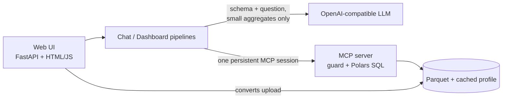
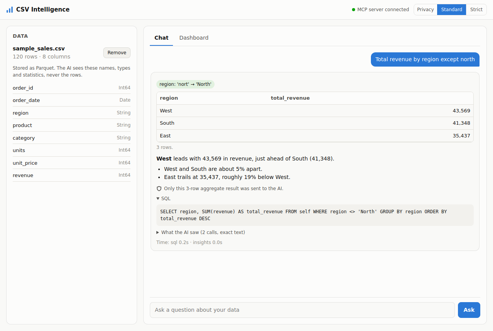
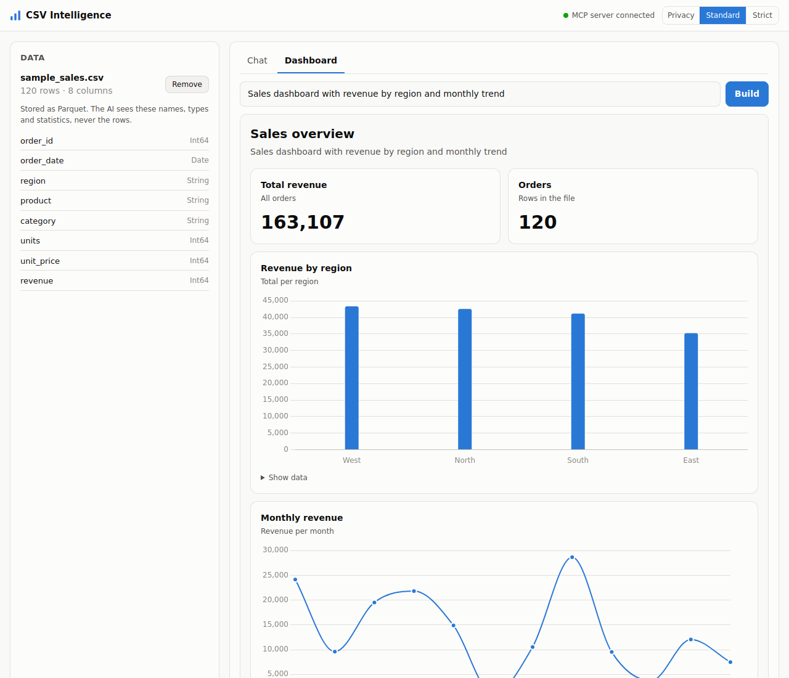

# MCP CSV Intelligence

Chat with a CSV or Excel file in plain English and turn it into an interactive dashboard.

The data work runs behind an [MCP](https://modelcontextprotocol.io) server (Polars SQL). Two small pipelines talk to
that server over one persistent MCP session.

- **Chat**: two LLM calls, no agent loop. Call 1 turns the question and the schema into one Polars SQL query. The
  server runs it, and the table is shown first. Call 2 writes insights from the result, but only when the result is a
  small aggregate and the privacy mode allows it. Otherwise the summary is written locally. If the SQL fails, one
  extra call fixes it.
- **Dashboard**: one LLM call plans 4–6 metrics (SQL + chart type) from the schema. All metric queries run in
  parallel, and a Jinja2 template renders the result as a self-contained page (Chart.js inlined, no CDN). Query
  results never go back to the LLM.
- **MCP server**: exposes `list_datasets`, `get_schema` and `run_sql` over HTTP. Each uploaded CSV or Excel file
  (`.xlsx`, `.xlsm`, `.xls`; first sheet) is converted once to Parquet, and its schema and summary statistics are
  cached next to it, so queries never re-parse the original file.



The pipelines never read the file directly. They find it and query it only through the MCP tools, and every
answer includes **What the AI saw**: the exact messages sent to the LLM.

| Chat | Dashboard |
|---|---|
|  |  |

<sub>Screenshots use the sample data and the real server. The model's replies (SQL, dashboard plan, insight text) were
scripted for the capture, so the numbers in the text match the table by construction.</sub>

---

## Setup (about 5 minutes)

You need **Python 3.11 or newer**, **git**, and an **API key** for an OpenAI-compatible LLM.

### Step 1. Clone the code

```bash
git clone https://github.com/arunak1998/mcp-csv-intelligence.git
cd mcp-csv-intelligence
```

### Step 2. Create a virtual environment

```bash
python -m venv .venv
source .venv/bin/activate        # Windows (PowerShell): .venv\Scripts\Activate.ps1
```

### Step 3. Install the package

```bash
pip install -e .
```

This installs everything, including the `langchain-openai` model package and the `csv-mcp-server` command.

> **Using a model that is not OpenAI-compatible** (Anthropic, Gemini, ...)? Install that provider's LangChain package,
> for example `pip install langchain-anthropic`, then swap the model class in
> [`src/csv_intelligence/agents/llm.py`](src/csv_intelligence/agents/llm.py). That file is the only place the model is created.

### Step 4. Add your API key

Copy the sample environment file:

```bash
cp .env.example .env             # Windows (PowerShell): copy .env.example .env
```

Open `.env` and set your key on the `LLM_API_KEY` line:

```
LLM_API_KEY=your_api_key_here
```

| Setting | Required? | What it is |
|---|---|---|
| `LLM_API_KEY` | **Yes** | Your API key. This is the only thing you must change. |
| `LLM_BASE_URL` | No | Only needed for an OpenAI-compatible gateway or proxy. Leave it out to use OpenAI directly. |
| `LLM_MODEL` | No | Model name. Default: `gpt-5-mini`. |
| `LLM_REASONING_EFFORT` | No | `minimal` makes gpt-5 / o-series models about 2x faster. Delete the line for other models such as `gpt-4.1`. |

`.env` is git-ignored, so your key is never committed.

### Step 5. Start the MCP server (first)

Open a terminal in the repository folder, activate the environment, and run:

```bash
csv-mcp-server
```

Leave it running. You should see `[server] listening on 127.0.0.1:8050`.

### Step 6. Start the UI (second terminal)

Open a **second** terminal in the same folder, activate the environment again (`source .venv/bin/activate`), and run:

```bash
csv-intelligence-web
```

Open <http://localhost:8000>. The top bar shows **MCP server connected** when step 5 worked. Set `WEB_PORT` to use
another port.

Run both commands from the repository root, so they share the `data/uploads` folder.

---

## Try it

1. In the **Data** panel, drop [`data/sample_sales.csv`](data/sample_sales.csv) (or any CSV or Excel file; for a workbook, the first sheet is used). Review the columns:
   anything that looks like personal data is pre-set to be masked. You can also rename columns. Then
   **Convert & load**.
2. **Chat** tab, ask:
   - *Which region has the highest total revenue?*
   - *Top 3 products by units sold*
3. **Dashboard** tab, ask: *Sales dashboard with revenue by region and monthly trend*
4. Open **What the AI saw** under any answer to see the exact text the LLM received. Switch **Privacy** to
   **Strict** to keep every query result on your machine.

A chat answer makes at most two LLM calls (three if the first SQL needs fixing). A dashboard makes one.

## Troubleshooting

| Problem | Fix |
|---|---|
| Top bar says **MCP server not running** | Do step 5 first, in its own terminal, from the repo root. Then refresh the page. |
| `Environment variable LLM_API_KEY is not set` | Create `.env` from `.env.example` (step 4) and set `LLM_API_KEY`. |
| `Unsupported parameter: reasoning_effort` | Your model is not a reasoning model. Delete the `LLM_REASONING_EFFORT` line in `.env`. |
| `command not found: csv-mcp-server` | Activate the virtual environment (step 2) and run `pip install -e .` again (step 3). |
| Port 8050 already in use | Set `MCP_PORT=8051` and `MCP_SERVER_URL=http://localhost:8051/mcp` in `.env`. |

## Project layout

```
src/csv_intelligence/
├── data/
│   ├── ingest.py           # CSV / Excel -> Parquet conversion (typed columns, clean headers)
│   ├── profile.py          # cached schema + summary statistics
│   ├── datasets.py         # dataset names, file locations, upload-folder sandbox
│   └── pii.py              # personal-data scan, masking and renaming
├── sql/
│   ├── guard.py            # sqlglot: one read-only SELECT on `self`
│   ├── analysis.py         # string filters, aggregate-only check
│   └── filters.py          # local filter-value matching
├── server/
│   ├── analyst.py          # FastMCP server: the three tools
│   └── sql_reference.py    # Polars SQL function list shown to the LLM
├── agents/
│   ├── chat.py             # question -> SQL -> table -> insights or local summary
│   ├── dashboard_agent.py  # plan -> parallel queries -> chart spec
│   ├── privacy.py          # what may reach the LLM; local summaries
│   ├── audit.py            # "What the AI saw"
│   ├── mcp_client.py       # one persistent MCP session
│   ├── dataset.py          # find the dataset + profile via MCP
│   ├── parsing.py          # helpers for LLM output
│   ├── prompts.py          # system prompts
│   └── llm.py              # the one place the LLM is created
├── dashboards/
│   ├── spec.py             # query results -> JSON chart spec
│   ├── render.py           # spec -> HTML (Jinja2)
│   ├── templates/          # dashboard.html
│   └── static/             # Chart.js (vendored)
├── formatting.py           # number formatting
├── web/
│   ├── app.py              # FastAPI: upload review, streaming chat, dashboards
│   ├── uploads.py          # stage + PII scan, then convert with the user's choices
│   └── static/             # index.html, app.js, app.css (no CDN)
└── settings.py
tests/                      # pytest suite (no network or API key needed)
data/sample_sales.csv       # sample data to try
.env.example                # sample settings: copy to .env
```

## Development

```bash
pip install -e ".[dev]"
pytest                          # tests use fakes; no API key needed
ruff check . && ruff format --check .
```

## Privacy

The data stays on your machine. The LLM gets a description of it, not the rows.

| What | How |
|---|---|
| **Schema-only prompts** | The LLM receives column names, types and summary stats (row count, nulls, distinct count, numeric/date min/max/mean). It never receives rows, text values or the file name. |
| **Local filter matching** | The LLM may write `region = 'south'`. Before the query runs, the MCP server matches `'south'` to the stored value `'South'` (case, spaces, close spellings such as `'laptops'` → `'Laptop'`). The answer reports what was changed, or that nothing matched. |
| **Aggregates-only insights** | After a query runs, its result goes to the LLM for insights only if it is a small aggregate (≤ `INSIGHT_MAX_ROWS`, default 20), is not grouped by an ID-like column, and uses no unmasked personal-data column. Otherwise the summary is written locally. |
| **Strict mode** | `PRIVACY_MODE=strict`: query results are never sent. The LLM only sees the schema and the question, and the summary is written locally from the result table. |
| **PII scan on upload** | Email and phone columns are flagged by their values; name, email and phone columns are also flagged by header. You can mask any column (values become stable tokens like `email_4821…`, so counts and grouping still work) or rename it before it is saved. Masked raw values are never written to disk. Personal-data columns get no min/max/mean in the profile. |

Name detection uses column headers only: values alone can't tell a person's name from a product name.

## Security notes

Every query passes these checks on the MCP server before it runs:

| Check | What it stops |
|---|---|
| **Upload-folder sandbox.** Tools take a dataset *name* (letters, digits, `_`, `-`) and the resolved file must be inside `UPLOAD_DIR`. | `../` paths, absolute paths, symlinks to files elsewhere |
| **SELECT only** (parsed with [sqlglot](https://github.com/tobymao/sqlglot)). Exactly one statement, and it must be a query. | `DROP`, `CREATE`, `DELETE`, `INSERT`, `COPY`, `SELECT ... INTO`, `SHOW`, stacked `; ...` statements |
| **Table allow-list.** Only `self` and the query's own CTEs can be read. | Polars SQL file functions such as `FROM read_csv('/etc/passwd')` or `read_parquet(...)` |
| **Row limit.** At most `MAX_RESULT_ROWS` rows (default 1000) are returned, with a `truncated` flag. | Dumping a large table |
| **Timeout.** The tool gives up after `QUERY_TIMEOUT_SECONDS` (default 10). | A runaway query blocking the answer. The Polars thread itself cannot be killed, so it finishes in the background. |

- The server listens on `127.0.0.1` only. Set `MCP_HOST=0.0.0.0` only inside a container or behind authentication.
- Never commit `.env` or share your API key.
