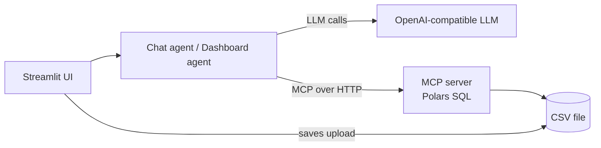

# MCP CSV Intelligence

Chat with a CSV file in plain English and turn it into an interactive dashboard.

The data work runs behind an [MCP](https://modelcontextprotocol.io) server (Polars SQL). Two LangChain / LangGraph
agents talk to that server to answer your questions.

- **Chat agent**: inspects the schema, writes one Polars SQL query, and answers with a summary, key insights and a table.
- **Dashboard agent**: plans metrics from the schema, runs each metric's SQL, and renders a single-file HTML dashboard
  (Tailwind + Chart.js).
- **MCP server**: exposes `get_files_list`, `get_schema` and `execute_polars_sql` over HTTP.



The agents never read the file directly. They find it and query it only through the MCP tools.

---

## Setup (about 5 minutes)

You need **Python 3.11 or newer**, **git**, and an **API key** for an OpenAI-compatible LLM.

### Step 1. Clone the code

```bash
git clone https://github.com/arunak1998/mcp-csv-intelligence.git
cd mcp-csv-intelligence
```

### Step 2. Create a virtual environment

```bash
python -m venv .venv
source .venv/bin/activate        # Windows (PowerShell): .venv\Scripts\Activate.ps1
```

### Step 3. Install the package

```bash
pip install -e .
```

This installs everything, including the `langchain-openai` model package and the `csv-mcp-server` command.

> **Using a model that is not OpenAI-compatible** (Anthropic, Gemini, ...)? Install that provider's LangChain package,
> for example `pip install langchain-anthropic`, then swap the model class in
> [`src/csv_intelligence/agents/llm.py`](src/csv_intelligence/agents/llm.py). That file is the only place the model is created.

### Step 4. Add your API key

Copy the sample environment file:

```bash
cp .env.example .env             # Windows (PowerShell): copy .env.example .env
```

Open `.env` and set your key on the `LLM_API_KEY` line:

```
LLM_API_KEY=your_api_key_here
```

| Setting | Required? | What it is |
|---|---|---|
| `LLM_API_KEY` | **Yes** | Your API key. This is the only thing you must change. |
| `LLM_BASE_URL` | No | Only needed for an OpenAI-compatible gateway or proxy. Leave it out to use OpenAI directly. |
| `LLM_MODEL` | No | Model name. Default: `gpt-5-mini`. |
| `LLM_REASONING_EFFORT` | No | `minimal` makes gpt-5 / o-series models about 2x faster. Delete the line for other models such as `gpt-4.1`. |

`.env` is git-ignored, so your key is never committed.

### Step 5. Start the MCP server (first)

Open a terminal in the repository folder, activate the environment, and run:

```bash
csv-mcp-server
```

Leave it running. You should see `[server] listening on 127.0.0.1:8050`.

### Step 6. Start the UI (second terminal)

Open a **second** terminal in the same folder, activate the environment again (`source .venv/bin/activate`), and run:

```bash
streamlit run src/csv_intelligence/ui/app.py
```

Your browser opens at <http://localhost:8501>. The sidebar shows **MCP server: running** when step 5 worked.

Run both commands from the repository root, so they share the `data/uploads` folder.

---

## Try it

1. In the sidebar, upload [`data/sample_sales.csv`](data/sample_sales.csv) (or any CSV).
2. **Chat** tab, ask:
   - *Which region has the highest total revenue?*
   - *Top 3 products by units sold*
3. **Dashboard** tab, ask: *Sales dashboard with revenue by region and monthly trend*

A dashboard takes about 30 seconds, and a chat answer about 10 seconds, with the default settings.

## Troubleshooting

| Problem | Fix |
|---|---|
| Sidebar says **MCP server: not running** | Do step 5 first, in its own terminal, from the repo root. Then refresh the page. |
| `Environment variable LLM_API_KEY is not set` | Create `.env` from `.env.example` (step 4) and set `LLM_API_KEY`. |
| `Unsupported parameter: reasoning_effort` | Your model is not a reasoning model. Delete the `LLM_REASONING_EFFORT` line in `.env`. |
| `command not found: csv-mcp-server` | Activate the virtual environment (step 2) and run `pip install -e .` again (step 3). |
| Port 8050 already in use | Set `MCP_PORT=8051` and `MCP_SERVER_URL=http://localhost:8051/mcp` in `.env`. |

## Project layout

```
src/csv_intelligence/
├── server/
│   ├── analyst.py          # FastMCP server: the three tools
│   └── sql_reference.py    # Polars SQL function list shown to the LLM
├── agents/
│   ├── csv_agent.py        # ReAct chat agent
│   ├── dashboard_agent.py  # plan -> query -> render pipeline
│   ├── data_context.py     # find the CSV + schema via MCP
│   ├── connection.py       # connect to the MCP server
│   ├── parsing.py          # helpers for tool/LLM output (unit-tested)
│   ├── prompts.py          # system prompts
│   └── llm.py              # the one place the LLM is created
├── ui/
│   ├── app.py              # Streamlit app
│   ├── uploads.py          # saving the uploaded CSV
│   └── health.py           # "is the MCP server up?" check
└── settings.py
tests/                      # pytest suite (no network or API key needed)
data/sample_sales.csv       # sample data to try
.env.example                # sample settings: copy to .env
```

## Development

```bash
pip install -e ".[dev]"
pytest                          # tests use fakes; no API key needed
ruff check . && ruff format --check .
```

## Security notes

- The server listens on `127.0.0.1` only. Set `MCP_HOST=0.0.0.0` only inside a container or behind authentication:
  its tools read any file path they are given and run arbitrary SQL on it.
- Never commit `.env` or share your API key.
